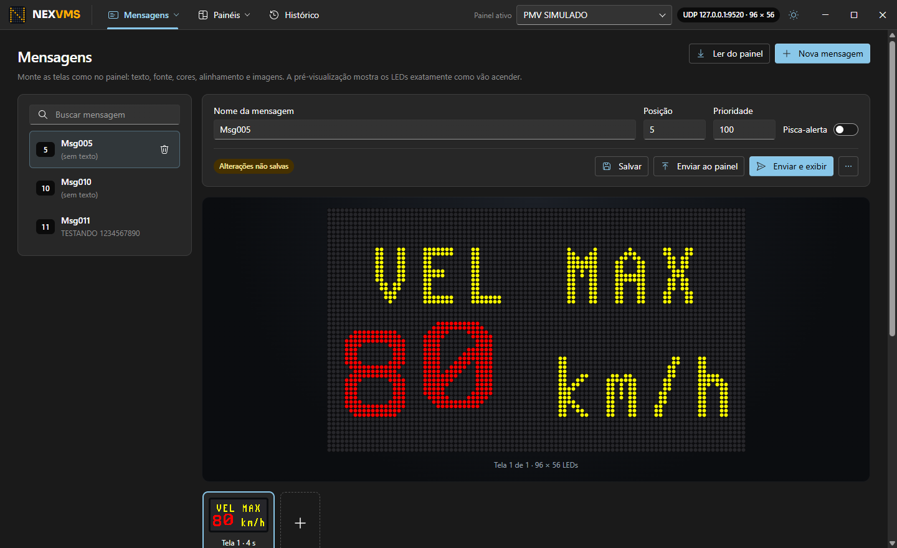

  <picture>
    <source media="(prefers-color-scheme: dark)" srcset="assets/logo-dark.png">
    
  </picture>

  <b>Next Generation Variable Message System</b> 
  Software gratuito para criar, enviar e acompanhar mensagens em painéis de mensagens variáveis (PMV).

  <a href="https://github.com/EzequielVieira/nexvms-releases/releases/latest"><b>Baixar a versão mais recente</b></a>

## Download

Na página da **[versão mais recente](https://github.com/EzequielVieira/nexvms-releases/releases/latest)**:

| Arquivo | Para quem |
| --- | --- |
| `NEXVMS-<versão>-setup.exe` | **Recomendado.** Instalador em português; cria atalhos e atualiza sozinho. |
| `NEXVMS-<versão>-win-x64.zip` | Versão portátil: descompacte e abra `NEXVMS.exe`. |

- Windows 10 (1809 ou mais novo) ou Windows 11, 64 bits. Não precisa instalar o .NET.
- O programa procura versões novas ao abrir e se atualiza com um clique.
- Para atualizar à mão, instale a versão nova por cima. Seus painéis, mensagens e fontes são mantidos.

## O que ele faz

- Editor de mensagens com pré-visualização dos LEDs, várias fontes e cores na mesma linha, imagens e objetos
  especiais (hora, data, temperatura, velocidade).
- Envio e ativação pelo NTCIP, mensagens automáticas, leitura das mensagens do painel.
- Busca de painéis na rede, configuração do controlador (incluindo rede e DHCP), situação do painel,
  diagnóstico de conexão, ferramentas e testes do display.

## Licença

O NEXVMS é gratuito (freeware). Todos os direitos reservados; o código-fonte não é distribuído.
Este repositório contém apenas os instaladores das versões publicadas.
